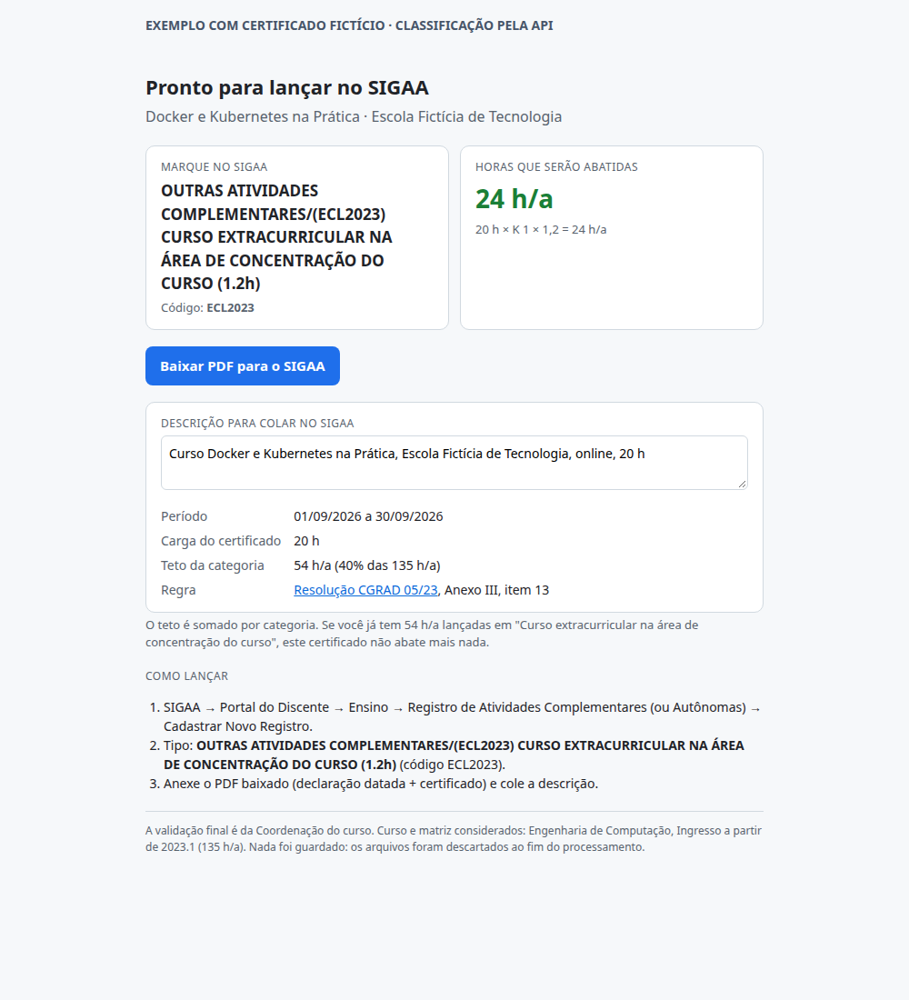
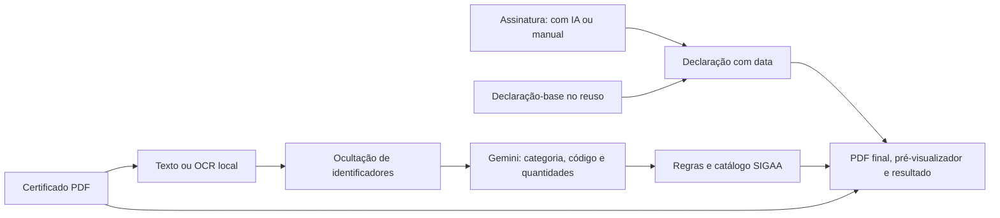

# Horas Complementares com IA

**Do certificado ao PDF para o portal acadêmico SIGAA, com classificação por IA e cálculo de horas rastreável.**

[Assista ao vídeo do projeto](https://lnkd.in/p/dp4rEizz)

Automação para estudantes de Engenharia de Computação e de Engenharia de Controle e Automação do
CEFET-MG Leopoldina. O aluno envia um certificado e recebe:

- **O código e a opção do SIGAA**, com descrição pronta para copiar.
- **Uma estimativa das horas aproveitáveis**, com conta, teto da categoria e fonte da regra.
- **Um único PDF**, com declaração de autenticidade preenchida, assinatura recortada, data e certificado.

**Estado atual:** em piloto numa VM da AWS, já usado por outros alunos do curso. Na medição da
autora, o registro de um certificado caiu de **21 min 49 s** (manual, um certificado cronometrado) para
**menos de 2 min** em cada um dos 5 certificados testados. A categoria saiu correta em **5 de 5**, conferida
pela autora (amostra pequena, testes da autora). Testado com 5 certificados reais e 3 fotos de assinatura
diferentes, com **83 testes automatizados passando**. A [projeção de economia](#resultado-nos-certificados-reais-e-projeção-de-economia)
está abaixo, com a conta visível e marcada como estimativa.

## Veja o resultado



Exemplo com o [certificado fictício de Docker e Kubernetes](samples/certificado-curso-docker.pdf),
processado pela API com o prompt `v2` e o Gemini. A imagem mostra a página de resultado gerada pelo
mesmo código do workflow; os dados são fictícios. A [saída registrada](docs/exemplos/curso-docker.json)
permite conferir a classificação, sem expor documentos de alunos.

| Entrada | Resultado deste exemplo |
|---|---|
| Curso de Docker, 20 horas, aluno de Computação no PPC novo | Curso extracurricular na área de concentração |
| Matriz atual | ECL2023 |
| Cálculo | 20 h × 1 × 1,2 = **24 h/a**, abaixo do teto de 54 h/a |

Este exemplo demonstra o funcionamento da integração. Não é certificado homologado nem medida de acurácia.

## O problema que motivou o projeto

Para registrar uma atividade complementar, o aluno precisa interpretar o certificado, escolher entre
opções semelhantes no SIGAA, descobrir como a carga será aproveitada e montar a documentação exigida.
O processo se repete a cada certificado. As regras variam por categoria, curso e matriz curricular.

Uma expressão como “participou do curso durante o estágio” pode induzir a escolha de prática
profissional, embora o comprovante seja de um curso. Participar de um congresso, apresentar um
trabalho e organizar o evento também exigem classificações diferentes.

A proposta é automatizar a preparação do pedido e deixar a decisão explicável para conferência.
A validação final da atividade e das horas continua sendo da Coordenação.

## Como o aluno usa

1. Seleciona o curso e a versão da **matriz atual**. Quem migrou de PPC seleciona a matriz de destino.
2. Envia o certificado em PDF. Documentos com páginas em imagem passam por OCR local quando necessário.
3. No primeiro uso, informa os dados, escolhe como preparar a assinatura (**com IA** ou **manual, sem
   IA**) e anexa a foto. O formulário explica o que acontece em cada opção, e nada é enviado antes da
   escolha. A ferramenta monta a declaração e gera também uma declaração-base para guardar.
4. Nos próximos certificados, envia a declaração-base. O sistema atualiza a data sem pedir os dados novamente.
5. Confere a categoria, a regra e os avisos; pré-visualiza o PDF gerado completo diretamente na tela antes de baixar e faz o registro no SIGAA.

Os dois cursos têm versões para ingresso até 2022.2 e a partir de 2023.1. Os totais, códigos,
[fontes e limitações do catálogo](regras/README.md) foram conferidos com PPCs e com o SIGAA público.

## Onde a IA entra — e como a resposta é conferida

O trabalho semântico fica com o modelo: interpretar o papel do aluno no certificado, classificar a
atividade e extrair quantidades. **O modelo não calcula horas nem inventa o código da matriz.**

| Etapa | Implementação | Motivo da escolha |
|---|---|---|
| Interpretação do certificado | Gemini com contexto do curso, exemplos e saída JSON com schema | Lidar com redações diferentes e categorias próximas |
| Extração de texto de páginas em imagem | Tesseract local | Ler certificados digitalizados antes da chamada ao LLM |
| Preparo da assinatura | Escolha do aluno: Gemini localiza a assinatura, ou recorte manual no navegador; a limpeza do fundo é sempre local | Dar ao aluno a decisão de enviar ou não a foto da assinatura a uma IA |
| Aproveitamento de horas | Fórmulas, fatores e tetos em JSON + JavaScript | Permitir cálculo reproduzível e consulta à fonte |
| Opção do SIGAA | Comparação pelo LLM com catálogo por matriz, categoria e variante | Escolher entre os tipos disponíveis respeitando o código daquele aluno |
| Declaração, pré-visualização e PDF final | Templates por curso, Gotenberg e pré-visualizador interativo | Permitir conferência visual completa do documento antes do download |

O [prompt v2](prompts/classificacao/v2.md) usa contexto do curso, exemplos de ambiguidades,
[schema de 31 categorias](prompts/classificacao/schema.json), comparação com tipos disponíveis no SIGAA
e instruções para tratar o certificado como dado. A saída traz alternativas e evidências faltantes; sua
confiança declarada não é uma probabilidade calibrada de acerto. As mudanças têm [histórico](prompts/CHANGELOG.md).

## Arquitetura



O [workflow n8n](workflows/horas-complementares.json) orquestra 35 nós. O código dos Code nodes fica em
[`n8n/codigo/`](n8n/codigo/), e o [gerador](n8n/montar-workflow.mjs) mantém o JSON exportado atualizado.
O formulário e a API `/webhook/classificar` compartilham a classificação e o cálculo; a API é usada na
avaliação e não fica exposta em produção. A prévia do recorte com IA passa por `/webhook/assinatura-ia`,
e o serviço Python só é acessível pelo n8n, na rede interna do Docker.

## O que já foi validado

| Evidência | Escopo |
|---|---|
| **45 testes JavaScript passando** | Cálculos, matrizes, códigos/opções do SIGAA, prompt, anonimização (nome fora de ordem, erros de OCR, links e códigos), workflow em dia com o código e versão do patch do n8n |
| **38 testes Python passando** | Datas, leitura de PDF, OCR, limites de renderização, rotas HTTP e recorte da assinatura (incluindo foto sobre mesa de madeira) |
| Fluxo da assinatura | Sem escolha nada é enviado; no modo manual o servidor recorta sem IA; com IA, uma única chamada |
| Auditoria de segurança e privacidade | Achados corrigidos: log de conteúdo, restos de dados no n8n, limites de upload e anonimização |
| Primeiro uso e reuso pelo formulário | PDF final com pré-visualizador em tela, assinatura tratada e declaração-base |
| Conferência visual dos modelos dos dois cursos | Campos, data, posição da assinatura e certificado |
| Exemplo fictício processado pela API real | Categoria na área, ECL2023 e 24 h/a para o curso de 20 horas |

Os testes de software **não medem a acurácia do LLM**. A avaliação de certificados homologados é
separada e usa [`evals/run_eval.py`](evals/run_eval.py): compara categoria, horas e alerta de instrução
suspeita, registrando também tokens e modo simulado. Os 5 certificados conferidos pela autora (abaixo)
mostram que o caso de uso funciona, mas não sustentam uma taxa de acerto para o produto.

## Resultado nos certificados reais e projeção de economia

**Amostra pequena, testes da autora.** São 5 certificados reais, conferidos pela própria autora, e não
certificados homologados pela Coordenação. Por isso o resultado abaixo mostra que a ferramenta funciona
no caso de uso, não uma taxa de acerto do produto.

| Medida | Valor | Fonte |
|---|---|---|
| Certificados reais testados | 5 | autora |
| Categoria correta | **5 de 5** | conferida pela autora |
| Tempo manual de referência | 21 min 49 s (um certificado) | cronometrado pela autora |
| Tempo na ferramenta | menos de 2 min em cada um | autora; não cronometrado um a um, então a conta usa 2 min como teto |
| Economia por certificado | **pelo menos 19 min 49 s** | 21 min 49 s − 2 min |
| Pedidos de atividade complementar | cerca de 300 por semestre | estimativa da autora |
| Alunos ativos no curso | cerca de 560 | estimativa da autora |

**Projeção (estimativa, não é medição):**

```
economia por pedido  = 21 min 49 s − 2 min             = 19 min 49 s (1.189 s), no mínimo
por semestre         = 1.189 s × 300 pedidos           ≈ 99 h
por ano (2 semestres)= 99,1 h × 2                      ≈ 198 h
```

Esse número é um **teto teórico**: supõe que todos os pedidos do curso passariam pela ferramenta e que o
tempo manual dos outros certificados seria igual ao do certificado cronometrado. O uso real é de poucas
vezes por ano por aluno: 300 pedidos por semestre para cerca de 560 alunos ativos dá cerca de 0,5 pedido
por aluno por semestre. **A adesão real e o número de alunos que de fato usam a ferramenta ainda não foram
medidos.** O piloto vai medir categoria e horas em pelo menos 20 certificados homologados e contar uso e
correções necessárias, com consentimento.

## Decisões de produto e aprendizados

- **Kit pessoal em vez de cadastro de alunos:** a declaração-base fica com a pessoa. Isso permite
  reuso sem manter um banco de assinaturas e documentos pessoais no projeto.
- **Regras conferíveis fora do LLM:** uma inferência de 570 h/a de Computação foi corrigida ao
  consultar o PPC, que separa AC de extensão. As matrizes ganharam testes. Fórmula, quantidade ou
  opção ausente agora pedem confirmação, sem preencher a lacuna com uma resposta inventada.
- **Documentos reais mudaram a solução:** a leitura de PDFs passou a incluir OCR, e o recorte da
  assinatura passou a procurar a tinta só dentro da folha, depois que os veios de uma mesa de madeira
  foram confundidos com a assinatura. Os casos encontrados viraram regressões.
- **A assinatura só vai para a IA se o aluno quiser:** a primeira versão enviava a foto ao Gemini assim
  que era anexada. Agora o aluno escolhe entre IA e recorte manual, com o aviso de que o plano gratuito
  do Google pode usar o conteúdo enviado.
- **Auditoria antes de crescer:** uma revisão de segurança achou restos de CPF e RG no banco do n8n e um
  log que gravava trechos de certificados. Arquivos de execução passaram a ficar só em memória, o banco
  é compactado a cada subida e os logs não registram conteúdo.

A construção foi assistida por IA na implementação, depuração, testes e documentação. As respostas
foram confrontadas com o comportamento do programa, documentos de referência e casos reproduzíveis.
Os erros encontrados viraram mudanças nas regras, no processamento ou nos testes.

## Como executar

Pré-requisitos: Docker com Compose, Node.js e um terminal com `sh`/Bash. No Windows, use Docker
Desktop com containers Linux e Git Bash. Python só é necessário no computador para testes e avaliações fora do container.

```bash
git clone https://github.com/catarina051/horas-complementares-ia.git
cd horas-complementares-ia
cp .env.example .env
```

No `.env`, preencha `GEMINI_API_KEY` e `N8N_ENCRYPTION_KEY`. Para gerar uma chave de criptografia:

```bash
node -e "console.log(require('node:crypto').randomBytes(32).toString('hex'))"
sh scripts/implantar.sh
```

Abra o [formulário local](http://localhost:5679/form/horas-complementares?v=20261031).
Sem chave do Gemini, o sistema entra em modo de demonstração e avisa que a classificação é simulada.

O script gera, importa e publica o workflow com o n8n parado antes de iniciá-lo novamente.

### Testar e demonstrar

Use os [certificados fictícios](samples/) para avaliar a ferramenta sem documentos pessoais.
As [instruções de validação](docs/VALIDACAO.md) incluem os comandos dos testes, a avaliação do prompt
e um roteiro curto de demonstração. O [gabarito de exemplo](evals/gabarito.example.csv) é sintético.

Há instruções para [compartilhar por túnel temporário](docs/VALIDACAO.md#compartilhar-para-um-piloto).
O piloto roda numa VM da AWS com HTTPS; a configuração (sem segredos) e o script de atualização
estão em [`deploy/`](deploy/README.md).

## Dados pessoais e limites

- **Dados:** o histórico do n8n não é persistido, os arquivos de cada execução ficam num volume em
  memória apagado a cada 30 minutos, o banco do n8n é compactado a cada subida e o serviço Python não
  registra o conteúdo das requisições. Nome informado, matrícula, RG, CPF e e-mails são mascarados antes do Gemini; padrões
  e OCR não garantem anonimização completa. A declaração é montada no servidor da ferramenta.
- **Assinatura:** o aluno escolhe. *Com IA*, a foto vai ao Gemini (plano gratuito, em que o Google
  pode usar o conteúdo para melhorar seus produtos) só para localizar a assinatura; o recorte e a
  remoção do fundo são locais. *Manual*, o aluno recorta no navegador e a foto não vai a nenhuma IA.
  O formulário explica as duas opções antes do envio, e nada é enviado antes da escolha.
- **Retenção:** não há cadastro de alunos. Há arquivos temporários durante o processamento e isso
  não garante ausência de retenção em toda a infraestrutura. Documentos de alunos, `.env`, resultados
  privados ficam fora do Git; as amostras e a captura do README são fictícias.
- **Escopo:** fotos ambíguas podem exigir novo envio. O recorte não autentica assinaturas e não
  produz assinatura digital criptográfica. O sistema não consulta saldo de horas, não envia pedidos ao
  SIGAA e não substitui a Coordenação. As lacunas do catálogo estão em [`regras/`](regras/README.md).

## Navegue pelo projeto

| Pasta | Conteúdo |
|---|---|
| [`n8n/`](n8n/) e [`workflows/`](workflows/) | Orquestração, código dos nós e workflow importável |
| [`prompts/`](prompts/) | Prompts v1/v2, schema e histórico de alterações |
| [`regras/`](regras/) | Fórmulas, matrizes, catálogo SIGAA e fontes |
| [`services/declaracao/`](services/declaracao/) | Extração de texto/OCR, datas e processamento da assinatura |
| [`templates/`](templates/) | Modelos de declaração dos dois cursos |
| [`tests/`](tests/) e [`evals/`](evals/) | Regressões de software e avaliação do classificador |
| [`deploy/`](deploy/) e [`scripts/`](scripts/) | Configuração de produção e scripts de implantação |

As referências acadêmicas e as decisões de cálculo estão em [`regras/README.md`](regras/README.md).
